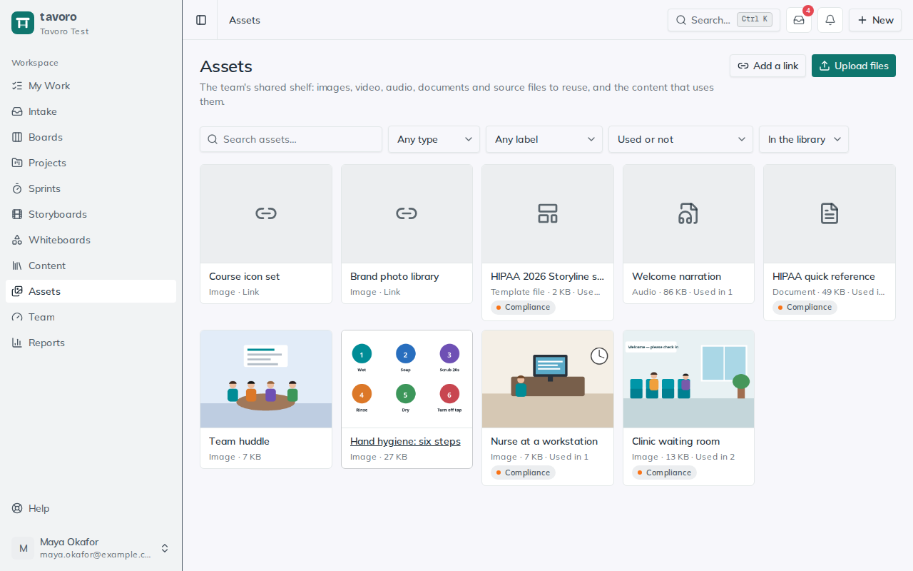
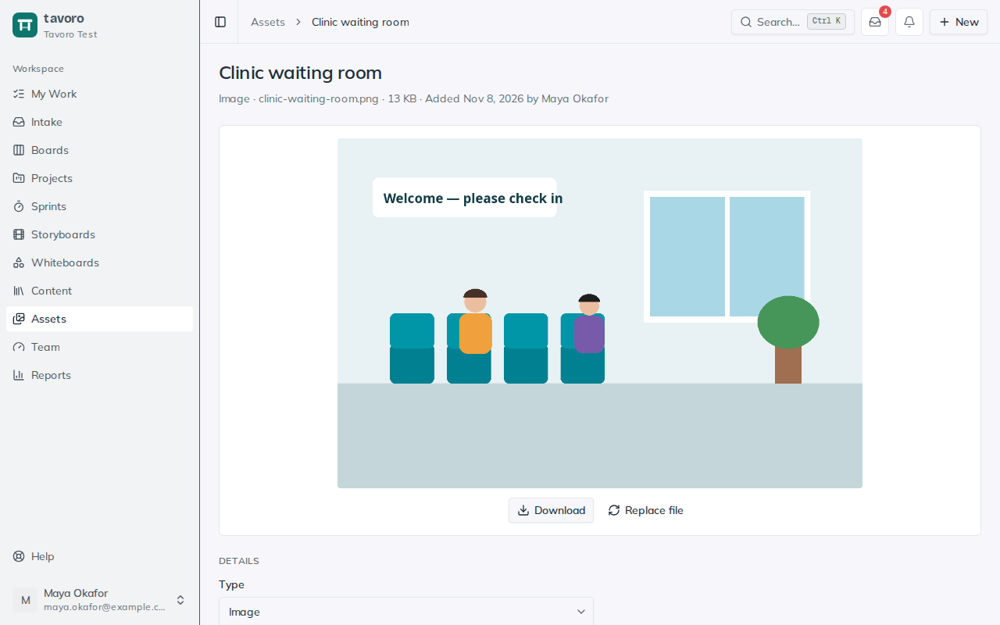

<!-- Generated from src/components/help by `npm run help:export`. Edit the app's help, not this file. -->

# Asset library

> **Assets** is your team’s shared shelf of reusable files: the photos, video clips, voice-over, icons, Storyline and PowerPoint sources, and brand templates that every project ends up hunting for again. Upload them once, or link to where they live, tag them with labels, and see which content uses each one.

The library holds files and pointers to them. It isn’t where you build a course; you still do that in your authoring tool. Like the content inventory, it belongs to the whole workspace: everyone in it can find and reuse every asset.

*The asset library.*

## Add assets

1. Open **Assets** in the sidebar and choose **Upload files**, or drop files anywhere on the page. You can upload several at once, up to 95 MB each.
2. Each upload is named after its file and given a type (**Image**, **Video**, **Audio**, **Document**, **Template file** or **Other**). Upload one file and its page opens so you can rename it and describe it straight away.
3. For something that lives elsewhere, such as a Drive folder, a Figma file or a stock library, choose **Add a link** instead. The library keeps the link, not a copy.

## An asset’s page

Images, video and audio play right on the page, and PDFs open in a new tab. Everything else, such as Office files, zips, SVGs and authoring-tool sources, downloads with **Download**. Tavoro decides what can be shown by reading the file itself, not its name, so a file can’t pass itself off as a picture.

**Description** — What it is, where it came from, and any licence or usage terms. For an image it’s also the alt text.

**Labels** — The workspace’s labels, the same ones cards and content use.

**Used in** — The content in the inventory that uses this asset.

*An image asset, previewed on its page.*

## Replace a file

When a photo is reshot or a template is updated, open the asset and choose **Replace file**. The asset keeps its name, labels and links to content; only the file changes, and the old one is deleted. A link asset has **Upload a file instead**, which turns it into an uploaded file.

## Record where assets are used

On a content item’s page, choose **Add from library** under **Assets**, or on an asset’s page choose **Add to content**. Then, when the photographer’s licence runs out or the logo changes, the asset’s **Used in** list shows every course to update. Removing an asset from content leaves it in the library.

## Find assets

Search by name, file name or description, and filter by type, label, or **Not used in any content** to find what’s sitting unused. Filters are kept in the address, so you can share a filtered view. Search (**Ctrl K**) finds assets by name too.

## Archiving and deleting

When an asset shouldn’t be reused any more, choose **Archive**. It leaves the library’s default view (choose **Archived** in the filter to see it) but keeps its file and its links to content. **Restore** puts it back.

> **Note.** Anyone in the workspace can add, edit, label and archive assets. Deleting removes the file for good, so only the person who added the asset, or an admin or manager, can delete it.

## Elsewhere in Tavoro

- AI assistants connected over MCP can find and describe assets, add links, label and archive them, and record which content uses them. Files themselves are uploaded in the app.
- Workspace backups include the library, with every uploaded file.

---

← [Content inventory](content.md) · [All guides](README.md) · [Templates](templates.md) →
