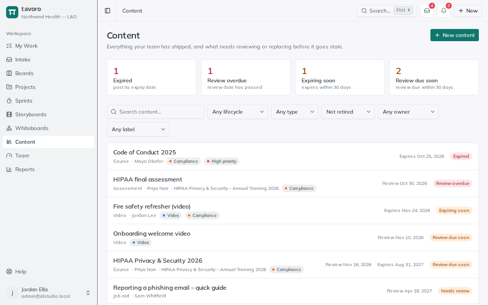
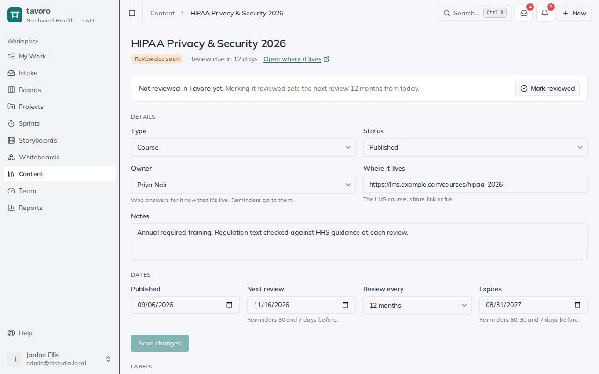

<!-- Generated from src/components/help by `npm run help:export`. Edit the app's help, not this file. -->

# Content inventory

> **Content** is your team’s inventory of what’s live: the courses, job aids, videos and documents you’ve shipped. Give each one a review date or an expiry date, and Tavoro tells you before it goes stale, instead of finding out when a learner spots the out-of-date policy.

Content lives on its own, not inside a project. Projects finish and get deleted; the compliance course they produced still has to be reviewed every year. When content came from a project, the item remembers which one, and it stays in the inventory even if that project is later deleted.

*Content: what needs attention first.*

## Add content

1. Open **Content** in the sidebar and choose **New content**. Give it a title and a type (**Course**, **Job aid**, **Video**, **Assessment**, **Document** or **Other**).
2. On its page, set the **Owner** (whoever answers for it now that it’s live), paste the link to **Where it lives**, and fill in the dates.
3. Choose **Save changes**.

Finished something in a project? On the project page, a deliverable whose status is **Complete** has a **Track in Content** button. It adds the deliverable to the inventory with its name, type and project filled in, published today and owned by you. Once tracked, the button becomes **In Content** and opens its record.

## Dates and reviews

**Published** — When it went live. For your records; nothing depends on it.

**Next review** — When someone should next check it’s still accurate.

**Review every** — The review cadence: 3, 6, 12 or 24 months. **Mark reviewed** uses it to set the next review date.

**Expires** — The date it must no longer be in use, such as the end of a certification year.

When you’ve checked an item and it’s still right, choose **Mark reviewed**. Tavoro records the date and moves the next review one cadence ahead (12 months if no cadence is set). If it was marked **Needs review**, it goes back to **Published**.

*A tracked course, with its review due in 12 days.*

## What the badges mean

Each item shows the most urgent thing about it:

**Expired** — The expiry date has passed. Replace or retire it.

**Review overdue** — The review date has passed.

**Expiring soon** — It expires within 30 days.

**Review due soon** — Its review is due within 30 days.

**Needs review** — Someone set its status to **Needs review**, for example because a policy it covers just changed.

**Current** — It has dates and none of them need attention yet.

**No dates set** — Nothing will remind you about it. Add a review or expiry date.

The four tiles at the top of the **Content** page count the items in the most urgent states; select one to filter the list to it. The list is sorted most urgent first, and you can filter by lifecycle, type, status, owner and label, or search by title and notes. Filters are kept in the address, so you can share a filtered view.

## Reminders

Tavoro emails ahead of each date, once per step:

- Reviews: 30 days before, 7 days before, and on the day.
- Expiry: 60, 30 and 7 days before, and on the day.

Reminders go to the item’s owner, or to the workspace’s admins and managers if it has none (or its owner has left). Changing a date starts its reminders over. Drafts and retired items get no reminders, and an overdue item isn’t emailed every day; it shows on the inventory, on the dashboard and on its owner’s **My Work** page until someone acts. Admins can switch these emails off under **Settings → Notifications → Content reviews & expiry**.

## Retiring and deleting

When content is no longer in use, choose **Retire**. It leaves the default list (choose **All, incl. retired** in the status filter to see it), stops reminding, and keeps its record, so “did we ever ship a course on this?” still has an answer. **Restore** brings it back.

> **Note.** Anyone in the workspace can add and edit content. Only admins and managers can delete an item, because deleting loses its history; retiring is usually what you want.

## Elsewhere in Tavoro

- **My Work** lists the content you own that’s due for review, expiring or overdue.
- The dashboard’s **Content health** panel counts what needs attention.
- Search (**Ctrl K**) finds content by title, retired items included.
- AI assistants connected over MCP can list, update and mark content reviewed, and track a deliverable.
- Workspace backups include the inventory.

---

← [Whiteboards](whiteboards.md) · [All guides](README.md) · [Templates](templates.md) →
