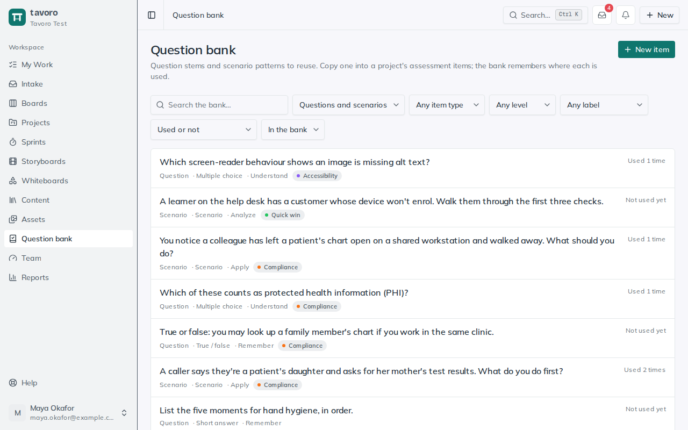
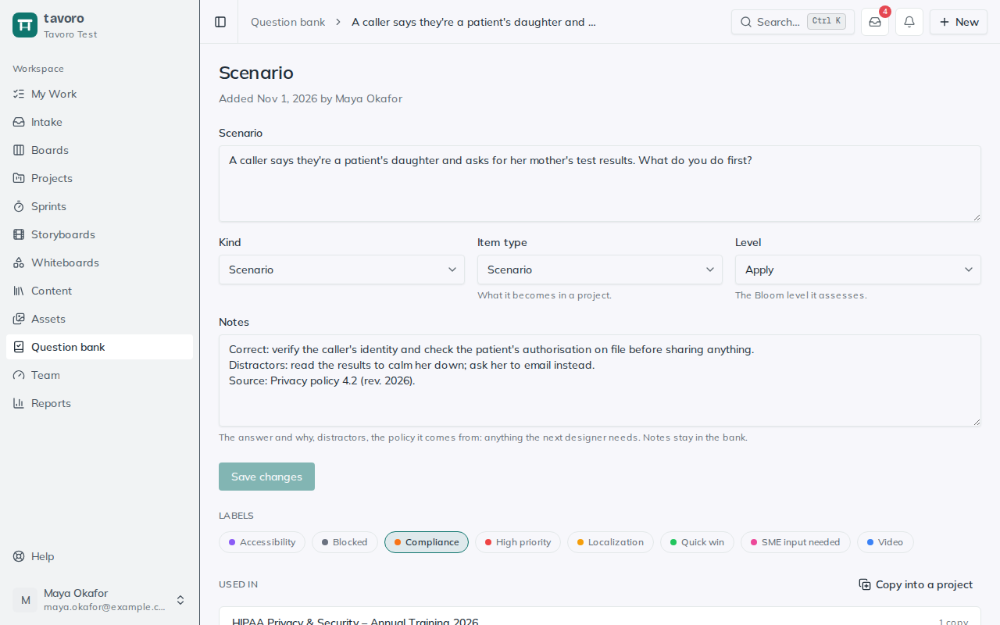

<!-- Generated from src/components/help by `npm run help:export`. Edit the app's help, not this file. -->

# Question bank

> The **question bank** holds the question stems and scenario patterns your team keeps rewriting: the privacy-breach scenario, the five-moments-of-hand-hygiene check, the “what do you do first?” question every compliance course needs. Write one once, then copy it into any project’s assessment items.

The bank stores the question, its type and level, and notes for the next designer. It isn’t an exam builder: you still build the finished assessment in your authoring tool. It belongs to the whole workspace, so everyone can find and reuse every item.

*The question bank.*

## Add to the bank

1. Open **Question bank** in the sidebar and choose **New item**. Write the question or scenario (up to 500 characters) and say whether it’s a **Question** or a **Scenario**.
2. On its page, set the rest and choose **Save changes**.

**Item type** — What it becomes in a project: **Multiple choice**, **True/false**, **Short answer**, **Scenario** or **Other**.

**Level** — The Bloom level it assesses, matching the levels on learning objectives.

**Notes** — The answer and why, the distractors, the policy it comes from. Notes stay in the bank; they aren’t copied into projects.

**Labels** — The workspace’s labels, so you can filter the bank by topic.

Already wrote a good question on a project? Under **Assessment items**, choose **Save to bank** on it. The bank entry takes its wording and type, and its level when the objectives it assesses share one.

## Use a bank item in a project

On a project, under **Assessment items**, choose **Add from the question bank** and pick one. Or, from a bank item’s page, choose **Copy into a project**. Either way, the project gets its own assessment item marked **From bank**; link it to the project’s objectives as usual.

> **Note.** A copy is independent. Rewording the bank entry never changes a course that’s already shipped, and tailoring the copy for one project never changes the bank.

*A scenario in the bank, and the projects that reuse it.*

## See where an item is used

A bank item’s **Used in** list shows every project holding a copy. Copies in projects you can’t open are counted but not named. When a policy changes, this is how you find every course whose questions need another look. Filter the bank by **Not used in any project** to find what nobody has picked up.

## Archiving and deleting

Choose **Archive** to stop an item being offered for reuse. It leaves the default view and the **Add from the question bank** list, but its record and its **Used in** list stay. **Restore** brings it back. Deleting removes it for good; copies in projects stay but no longer say where they came from. Only the person who added an item, or an admin or manager, can delete it.

## Elsewhere in Tavoro

- Search (**Ctrl K**) finds bank items by their wording.
- Project templates remember which assessment items came from the bank.
- AI assistants connected over MCP can search the bank, add and edit items, copy them into projects, and save a project’s assessment items to the bank.
- Workspace backups include the bank.

---

← [Asset library](assets.md) · [All guides](README.md) · [Templates](templates.md) →
