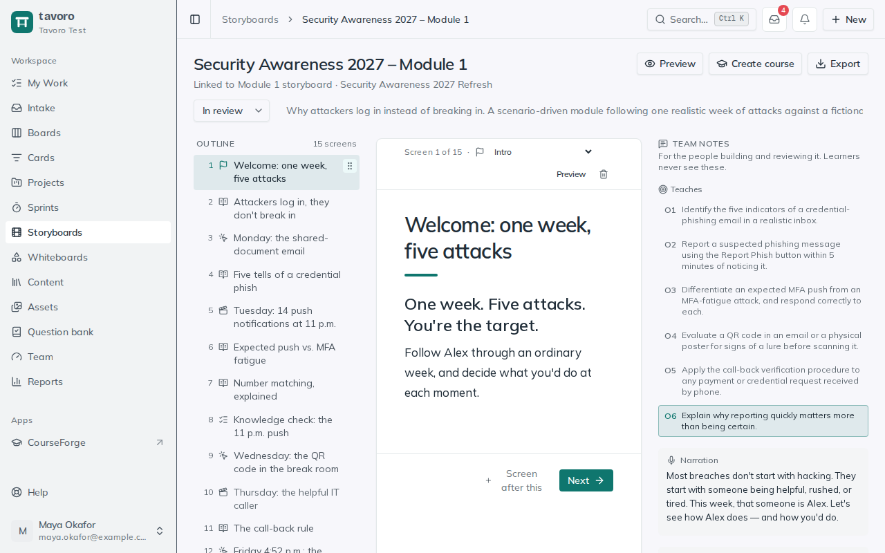

<!-- Generated from src/components/help by `npm run help:export`. Edit the app's help, not this file. -->

# Storyboards

> A **storyboard** is your screen-by-screen blueprint for a course — the plan a SME reviews and a developer builds from, before anyone opens an authoring tool. Each screen captures its type plus the on-screen text, narration, and the visual, interaction, and developer notes that spell out exactly what to build.

## Create a storyboard

Storyboards live under **Storyboards** in the sidebar. You can create one on its own, or generate one already linked to a project deliverable (see below).

1. Choose **New storyboard** on the **Storyboards** page (or **New → Storyboard**in the header), type a name in **Storyboard title…**, and choose **Create**.
2. Open it, then set the **Status** — **Draft**, **In review**, or **Approved** — and add a description to frame the course.
3. Build it out screen by screen (below). Rename the storyboard anytime by clicking its title; **Delete storyboard** removes it and its screens.

To start from a storyboard you’ve built before, pick it under **Start from** in the same dialog. Any storyboard can be saved as one with **Save as template** at the bottom of its page (see [Templates](templates.md)).

> **Note.** The storyboard **Status** tracks its overall state, and each card in the storyboards grid shows its status and screen count — a quick read on what’s still in draft versus ready for a SME.

## Screens

*A storyboard with the first screen open.*

Screens are the ordered building blocks of the course. Add one with **Add a screen**, give it a title, and it appears at the end of the list, numbered in sequence. Click a screen’s arrow to expand it and edit its fields; collapse it again to keep the outline scannable.

- **Rename** — click the screen title to edit it inline.
- **Reorder** — use the up and down arrows to move a screen; the numbering updates to match.
- **Delete** — the screen’s delete button removes it (you’ll be asked to confirm).

### Screen type

The type dropdown on each screen labels its role in the course flow, so the whole sequence reads as a lesson at a glance:

**Intro** — Sets up the course or module — objectives, agenda, welcome.

**Content** — The core teaching screens carrying the substance.

**Video** — A video segment or demonstration.

**Knowledge check** — A quick, low-stakes check for understanding.

**Interaction** — A click-to-reveal, drag-and-drop, scenario, or other activity.

**Assessment** — A graded or formal check of mastery.

**Summary** — Wrap-up, recap, and next steps.

### The per-screen fields

Expand a screen to find five rich-text fields — each supports bold, italic, an H2 heading, and bulleted or numbered lists, and saves automatically when you click out. Together they give a developer everything needed to build the screen:

**On-screen text** — Exactly what the learner will read on the screen.

**Narration / VO** — The voiceover or audio script for the screen.

**Visual & media notes** — The imagery, graphics, layout, and media direction — what it should look like.

**Interaction & branching** — How the learner interacts and where the course goes next — clicks, drags, branches, logic.

**Developer notes** — Build instructions for whoever assembles it in the authoring tool.

### Which objectives a screen teaches

On a storyboard linked to a project, each screen’s **Teaches** control picks the project’s learning objectives it covers. That feeds the project’s alignment view, so you can see which objectives are taught and assessed, and which aren’t yet. See *Objectives & alignment*.

> **Tip.** Keep **On-screen text** and **Narration** distinct — reviewers read them differently, and separating them makes SME feedback far cleaner than one blended “script.”

## Linking a storyboard to a project

Storyboards are strongest when tied to the project they serve. On a project’s **Storyboard**-type deliverable, click **Create storyboard** to generate one already linked to that deliverable; afterward the button reads **Open storyboard**. A linked storyboard shows its project and deliverable at the top of the page, and routes through that deliverable’s SME review cycles.

You can still create standalone storyboards from the **Storyboards** page for early exploration — they simply won’t show a project link until you build one through a deliverable.

## Export

**Export** at the top of a storyboard gives you a **Word document** (to edit or send) or a **PDF** (a print view: choose **Save as PDF** in the print dialog), screen by screen with every field that has content. To export a storyboard together with an SME’s comments, use **Export** on the review round instead.

## Whiteboards on a storyboard

Every storyboard has a **Whiteboards** section for the loose, visual thinking that precedes tidy screens — sketching a course flow, roughing out a wireframe, or mapping a branching scenario. Click **New whiteboard** to create an Excalidraw canvas linked to the storyboard; it appears as a card you can open anytime.

> **Access.** Storyboards are visible to all workspace members by default. An admin can restrict one to specific groups in **Settings → Groups**, and access is enforced everywhere — the list, the dashboard, and direct links alike. Admins and managers always see every storyboard.

---

← [Sprints](sprints.md) · [All guides](README.md) · [Whiteboards](whiteboards.md) →
