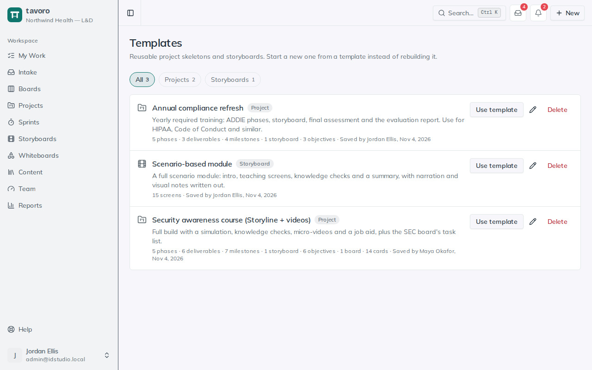

<!-- Generated from src/components/help by `npm run help:export`. Edit the app's help, not this file. -->

# Templates

> A **template** is a project or storyboard you can start from again. Save the annual compliance refresh once, with its phases, deliverables, storyboard and boards, and next year’s refresh starts there instead of from a blank page.

*Templates: every reusable skeleton in the workspace.*

## Save a template

1. Open the project or storyboard you’d like to reuse.
2. At the bottom of its page, choose **Save as template**.
3. Name it, say what it’s for, and choose **Save template**.

The template is a copy: later changes to the project or storyboard don’t change it, and deleting the project doesn’t delete it. To update a template, make your changes in a project, choose **Save as template** again and pick **Replace “…”**.

## What’s copied

**Project templates** — The methodology and description; the phases, with their dates; milestones; deliverables and their phases; the storyboard of each storyboard deliverable, screen by screen; learning objectives, assessment items and how they align; and the project’s boards, with their columns and cards (title, description, labels and subtasks), all starting in the board’s first to-do column.

**Storyboard templates** — Every screen, with its type and all its text: on-screen text, narration, visuals, interaction and developer notes.

**Not copied** — Anything that belongs to one particular run: statuses (everything starts **Not started**), assignees, SMEs, owners, comments, review rounds and files, time entries, attachments, card due dates and sprints. A storyboard template also leaves out objective links, because objectives belong to a project.

## Start from a template

Choose **New project** or **New storyboard** and pick the template under **Start from**, or choose **Use template** on the **Templates** page. For a project you also pick a **Start date**: phase and milestone dates keep their spacing from the template and move to start on that day. A phase that began two weeks in still begins two weeks in.

## Managing templates

The **Templates** page (linked from the top of **Projects** and **Storyboards**) lists every template with what it contains and who saved it.

- Anyone in the workspace can use templates and save new ones.
- Whoever saved a template, and admins and managers, can rename, replace or delete it.
- Deleting a template doesn’t touch the projects or storyboards already made from it.

> **Note.** Templates are visible to the whole workspace, even when the project or storyboard they came from is restricted to some groups. Check what’s in it before you save one from a confidential project.

## Elsewhere in Tavoro

- AI assistants connected over MCP can list templates, start a project or storyboard from one, and save new ones.
- Workspace backups include templates.

---

← [Question bank](question-bank.md) · [All guides](README.md) · [Intake](intake.md) →
